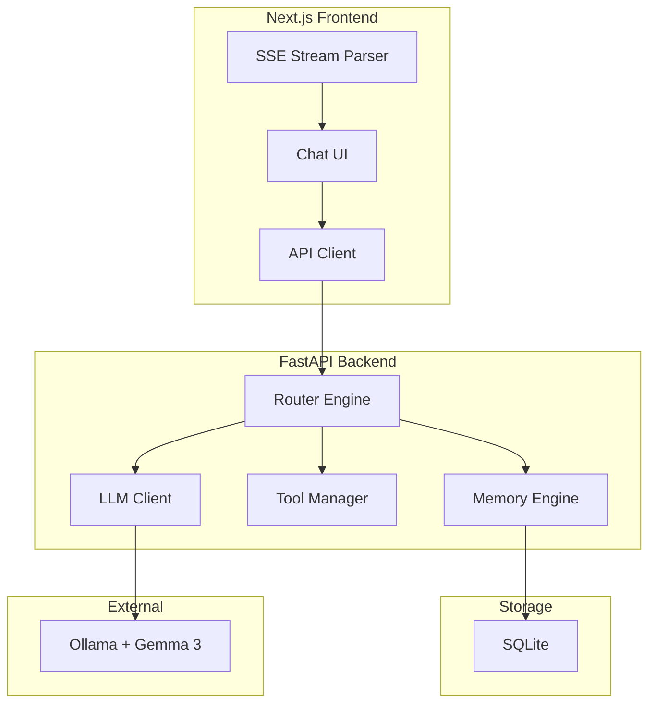

# AURA AI — Autonomous Universal Reasoning Agent

> **Developer & Owner**: Ketan Lade  
> **Phase 1**: Foundation Architecture

An AI Operating System built with **FastAPI** (Python) + **Next.js** (TypeScript), powered by **Ollama** with **Gemma 3** model support.

## Architecture



## Features

- **Router Engine** — Intent detection with keyword fast-path + LLM fallback
- **Memory Engine** — Two-tier memory (in-memory cache + SQLite persistence)
- **Tool Manager** — Plugin architecture with built-in tools:
  - 🧮 Calculator (safe AST-based math evaluation)
  - 📄 File Reader (sandboxed text file reading)
  - 💻 System Info (OS, CPU, memory, disk via psutil)
- **Streaming Chat** — Real-time SSE streaming with token-by-token display
- **Autonomous Agent Mode** — Plans software goals, writes project files, runs verification, repairs failures, and reports live phase progress
- **Conversation History** — Full CRUD with auto-title generation
- **ChatGPT-style UI** — Dark theme, glassmorphism, animations

## Tech Stack

| Layer | Technology |
|-------|-----------|
| Frontend | Next.js 15, TypeScript, Tailwind CSS 4 |
| Backend | Python 3.14, FastAPI, aiosqlite |
| LLM | Ollama (local), Gemma 3 |
| Database | SQLite (WAL mode) |
| Streaming | Server-Sent Events (SSE) |

## Quick Start

### Prerequisites

- Python 3.10+
- Node.js 18+
- [Ollama](https://ollama.ai) installed and running

### 1. Pull the Gemma 3 Model

```bash
ollama pull gemma3:1b
```

### 2. Backend Setup

```bash
cd backend

# Create virtual environment
python3 -m venv venv
source venv/bin/activate  # macOS/Linux
# venv\Scripts\activate   # Windows

# Install dependencies
pip install -r requirements.txt

# Start server
uvicorn app.main:app --reload --port 8000
```

### 3. Frontend Setup

```bash
cd frontend

# Install dependencies
npm install

# Start dev server
npm run dev
```

### 4. Open the App

Navigate to **http://localhost:3000**

## API Documentation

Interactive docs available at **http://localhost:8000/docs** when backend is running.

### Key Endpoints

| Method | Endpoint | Description |
|--------|---------|-------------|
| `GET` | `/api/v1/health` | Health check |
| `POST` | `/api/v1/chat` | Chat (SSE stream) |
| `GET` | `/api/v1/conversations` | List conversations |
| `POST` | `/api/v1/conversations` | Create conversation |
| `GET` | `/api/v1/conversations/{id}` | Get conversation + messages |
| `PATCH` | `/api/v1/conversations/{id}` | Update title |
| `DELETE` | `/api/v1/conversations/{id}` | Delete conversation |
| `GET` | `/api/v1/memory/{id}` | Get conversation memory |
| `GET` | `/api/v1/memory/search/?q=...` | Search memory |
| `GET` | `/api/v1/tools` | List tools |
| `POST` | `/api/v1/tools/{name}/execute` | Execute tool |

### Chat SSE Events

| Event | Data | Description |
|-------|------|-------------|
| `conversation_id` | `{conversation_id}` | Assigned conversation ID |
| `token` | `{content}` | Streaming text chunk |
| `tool_use` | `{content, metadata}` | Tool being invoked |
| `tool_result` | `{content, metadata}` | Tool execution result |
| `agent_progress` | `{content, metadata}` | Autonomous phase status (`pending`, `running`, `completed`, or `failed`) |
| `done` | `{}` | Response complete |
| `error` | `{content}` | Error occurred |

## Project Structure

```
AURA AI/
├── backend/
│   ├── app/
│   │   ├── main.py              # FastAPI entry point
│   │   ├── config.py            # Settings
│   │   ├── api/routes/          # API endpoints
│   │   ├── core/                # Router, Memory, Tool, LLM engines
│   │   ├── models/              # DB + Pydantic schemas
│   │   └── tools/               # Built-in tool plugins
│   ├── requirements.txt
│   └── venv/
├── frontend/
│   ├── src/
│   │   ├── app/                 # Next.js pages
│   │   ├── components/          # React components
│   │   ├── hooks/               # Custom hooks
│   │   ├── lib/                 # API client + SSE parser
│   │   └── types/               # TypeScript definitions
│   └── package.json
└── README.md
```

## Configuration

### Environment Variables (Backend)

| Variable | Default | Description |
|----------|---------|-------------|
| `AURA_OLLAMA_BASE_URL` | `http://localhost:11434` | Ollama API URL |
| `AURA_OLLAMA_MODEL` | `gemma3:1b` | Default LLM model |
| `AURA_DATABASE_PATH` | `./aura.db` | SQLite database path |
| `AURA_CORS_ORIGINS` | `["http://localhost:3000"]` | Allowed CORS origins |
| `AURA_DEBUG` | `true` | Debug mode |
| `AURA_AUTONOMOUS_MAX_REPAIR_ATTEMPTS` | `2` | Maximum verification/repair cycles per autonomous run |
| `AURA_AUTONOMOUS_COMMAND_TIMEOUT` | `90` | Timeout in seconds for autonomous verification commands |

## Autonomous Agent Mode

Turn on **Agent Mode** above the chat composer, then describe a software goal. AURA will:

1. Decompose the goal into persisted planner tasks.
2. Create or reuse the conversation's active project workspace.
3. Generate complete source and configuration files inside `user_files/Projects/`.
4. Run local syntax, configuration, build, and test checks when available.
5. Feed failures into a repair loop and re-run verification.
6. Leave deployment pending until a target and credentials are configured.

Generated paths are restricted to the active project sandbox. File size, file type, execution timeout, and repair-attempt limits are enforced by the backend.

### Environment Variables (Frontend)

| Variable | Default | Description |
|----------|---------|-------------|
| `NEXT_PUBLIC_API_URL` | `http://localhost:8000/api/v1` | Backend API URL |

## Adding Custom Tools

Create a new file in `backend/app/tools/`:

```python
from app.tools.base import BaseTool
from app.models.schemas import ToolResult

class MyTool(BaseTool):
    @property
    def name(self) -> str:
        return "my_tool"

    @property
    def description(self) -> str:
        return "Description for the LLM"

    @property
    def parameters(self) -> dict:
        return {
            "type": "object",
            "properties": {
                "param1": {"type": "string", "description": "..."}
            },
            "required": ["param1"],
        }

    async def execute(self, **kwargs) -> ToolResult:
        # Your logic here
        return ToolResult(success=True, output="Result")
```

Register in `backend/app/core/tool_manager.py`:

```python
def register_defaults(self) -> None:
    # ... existing tools ...
    from app.tools.my_tool import MyTool
    self.register(MyTool())
```

## Phase 2 Roadmap

- [ ] Vector embeddings for semantic memory search
- [ ] Internet search tool
- [ ] Voice input/output
- [ ] Multi-agent orchestration
- [ ] Browser automation
- [ ] Vision capabilities
- [ ] Authentication system
- [ ] Docker deployment

## Developer & Owner

**Ketan Lade**

---

## License

Private — AURA AI Project - Owned and Developed by Ketan Lade
